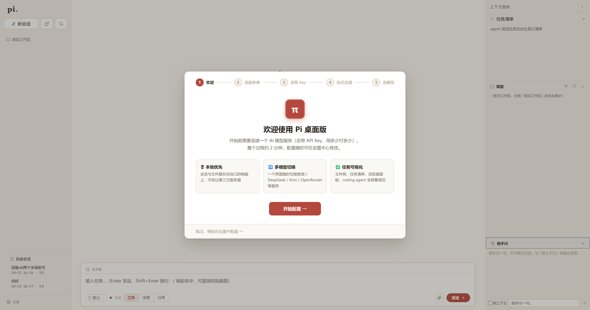
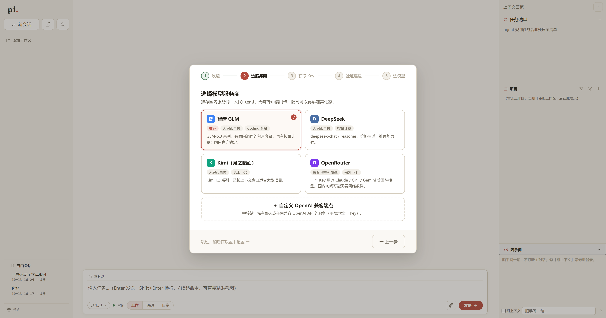
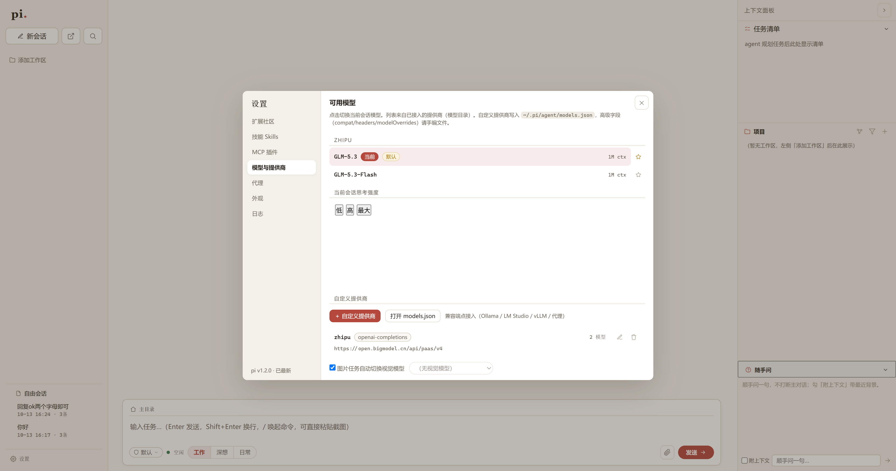

# Pi 桌面版（pi-gui）

> 给 [pi coding agent](https://github.com/earendil-works/pi) 套一层 Electron 图形界面——多会话并行、项目文件树、任务清单、内置浏览器、随手问辅助对话。Windows 桌面应用，下载即用。

**社区第三方项目，与 pi 官方无关。** 中文界面 · MIT 许可 · 本地优先（会话与文件都在你自己的电脑上）



## 它能做什么

- **开箱即用的配置引导**：首次启动自动弹出向导，选服务商 → 拿 Key → 粘贴验证 → 选模型，全程约 2 分钟
- **多会话并行**：多个任务同时跑，互不打断；后台任务的会话有标记，完成有通知
- **场景三档**：工作 / 深想 / 日常一键切换思考强度，档位按你接入的模型自动适配
- **项目文件树**：左侧管理多个项目工作区，文件单击查看、双击 @ 引用
- **内置浏览器**：agent 可以直接操作网页（打开/点击/填表/截图），也有给你用的浏览面板
- **内置工程技能**：预装 12 个开源工程方法论技能（TDD、代码评审、分相工作流等），开箱即有高质量输出
- **任务可视化**：任务清单、变更列表、上下文用量环、token/费用统计
- **随手问**：侧边栏辅助小对话，不打断主任务

| | |
|---|---|
|  |  |

## 下载安装

从 [GitHub Releases](../../releases) 下载最新 `pi-gui-setup-<版本>.exe`，双击安装（可自选目录），桌面图标双击启动。

> 安装包无代码签名，首次运行如遇 SmartScreen 提示，点「更多信息 → 仍要运行」。

## 首次配置

启动后会自动进入配置向导：

1. **选服务商**——内置智谱 GLM（推荐，Coding 套餐）/ DeepSeek / Kimi / OpenRouter，也可接任意 OpenAI 兼容端点（中转站、Ollama、vLLM 等）
2. **拿 Key**——向导里有各家的注册步骤图文
3. **验证连通**——粘贴 Key 后点「测试连接」，只查一次模型列表，零费用
4. **选默认模型**——完成，开聊

Key 只保存在你电脑的 `~/.pi/agent/models.json`，不上传任何地方；计费由服务商直接结算，本项目不经手。

**前置依赖**：完整功能需要系统装有 [Git for Windows](https://git-scm.com/download/win)（提供 bash，agent 执行命令用）；如需使用 npx 型 MCP 插件，另装 [Node.js](https://nodejs.org/)。

## 从源码运行

```bat
git clone <本仓库>
cd pi-gui
npm install
npm start
```

- 需要 Node.js 18+ 与 Git for Windows
- `npm test` 运行自动化验证（大部分零 token；个别用例发极短真实消息）
- `npm run dist` 构建安装包（输出到 `dist-out/`）

## 常见问题

**Key 安全吗？** Key 明文存在你本机 `~/.pi/agent/models.json`（与 pi TUI 同一目录、同一格式，可通用）。本项目代码不包含任何上传逻辑，可自行审计。

**杀毒软件报毒？** 无签名的 Electron 安装包常见误报。安装包由 GitHub Actions/本地 electron-builder 直接产出，可对照源码自行构建。

**支持 macOS / Linux？** 目前仅 Windows（Win10/11 实测）。其他平台欢迎 PR。

**和 pi TUI 什么关系？** 共享同一套数据目录 `~/.pi/agent`——你在 TUI 配的技能、MCP、会话，GUI 里直接就有；反之亦然。没用过 pi TUI 也完全不影响，向导会带你从零配置。

**智谱 Key 填哪种？** 推荐 Coding 套餐的 Key（完整思考档位）；开放平台按量 Key 也可用，但思考档位上限不同（详见向导提示）。

## 已知限制

- 思考档位按接入端点的真实能力自动适配（如 OpenAI 兼容端点最高到 high，官方协议可到 max）
- 测试体系面向 Windows 开发环境；CDP 类用例需要本机起 Electron 实例，暂无 CI
- 自动更新未实现——看版本号手动重下（仓库右上角 Watch 可接收 Release 通知）

## 维护声明

个人项目，**best-effort 维护**：issue 有空就看、修得了就修，不承诺响应时限。欢迎 PR。

## 致谢

- [pi coding agent](https://github.com/earendil-works/pi) —— 本项目为其图形壳，核心能力全部来自 pi（MIT）
- 内置技能移植自 [mattpocock/skills](https://github.com/mattpocock/skills)、[emilkowalski/skills](https://github.com/emilkowalski/skills)、[humanlayer/skills](https://github.com/humanlayer/skills)（均 MIT）
- 完整第三方清单见 [THIRD-PARTY-NOTICES.md](THIRD-PARTY-NOTICES.md)

## 许可证

[MIT](LICENSE)
